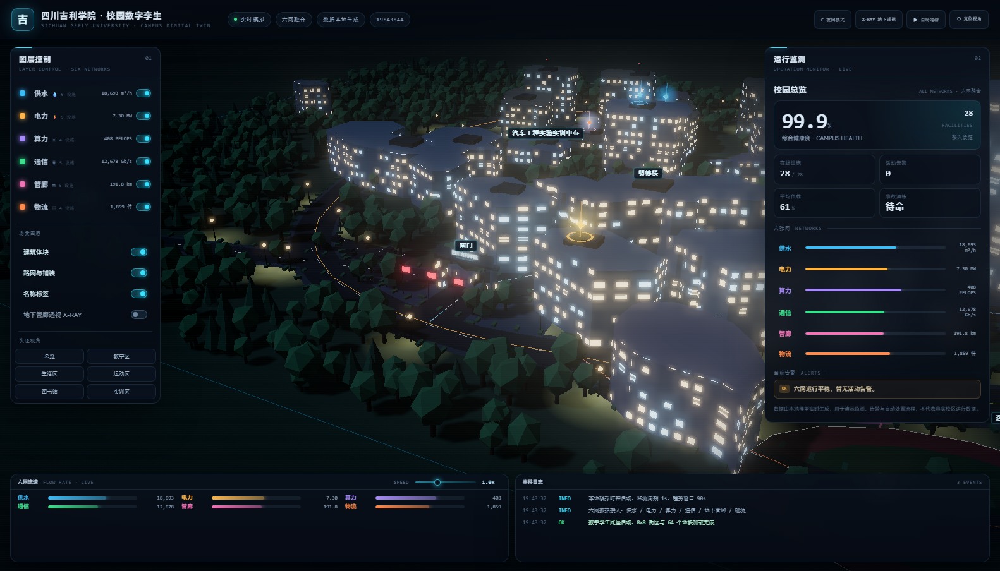
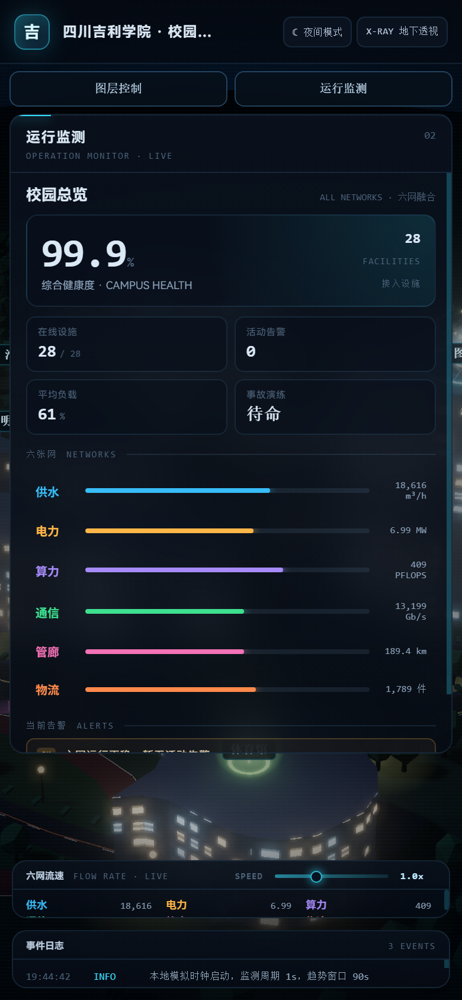
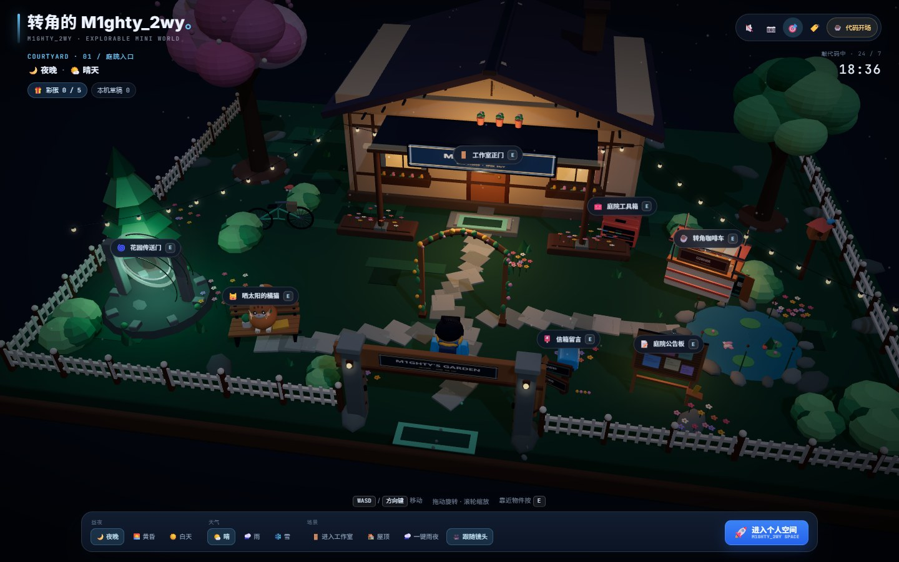
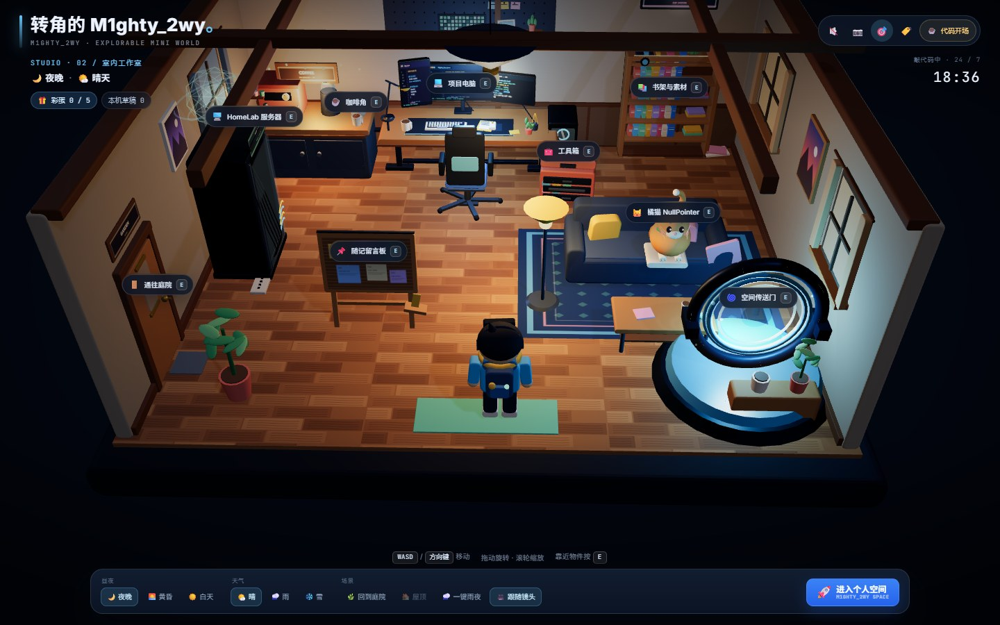
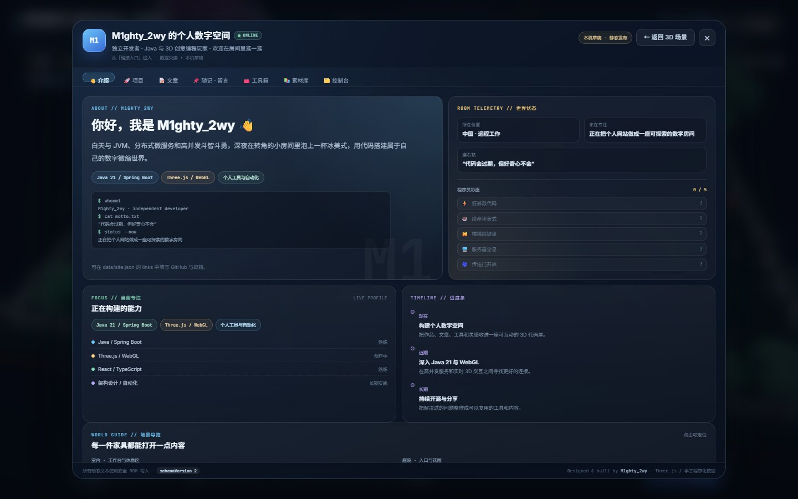
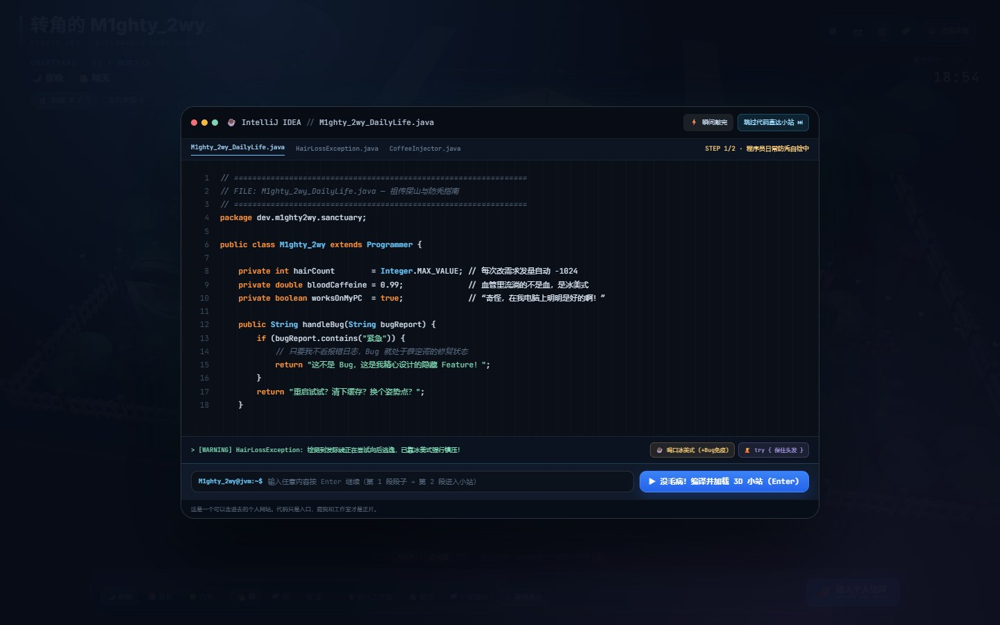
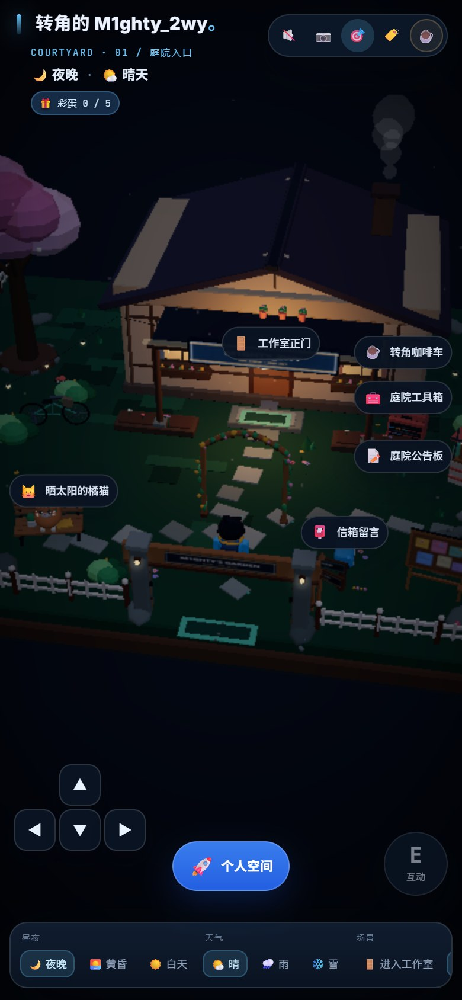

# 转角的 M1ghty_2wy

一座可以走进去的 3D 个人空间：暖色低多边形庭院、可进入的极客工作室、第三人称角色、统一物件交互，以及项目 / 文章 / 工具 / 素材 / 随记 / 留言的静态内容系统。

入口仍是 `index.html`，不依赖应用框架或打包器；Three.js 以本地 ES module vendored 到 `vendor/three.module.js`（v0.160.1，MIT），UI 样式已编译到 `assets/styles.css`。公开站点可直接静态部署。管理工作台使用 Node.js，无需安装 npm 依赖或构建。

## 配套项目：校园数字孪生 Demo

同一仓库下的第二个独立项目，单文件 Three.js 数字孪生演示：

- 在线体验：**https://wangweiye.top/city-twin/**
- 源码：[city-twin/index.html](city-twin/index.html)（单文件，含校园数据与全部逻辑）
- 说明：[city-twin/README.md](city-twin/README.md)

**51 栋楼栋**的轮廓、层高、名称来自学校官方可视化位置服务平台；在此之上叠加供水、电力、算力、通信、地下管廊、物流六张网，支持单网聚焦、设施详情、事故演练、90 秒趋势、X-RAY 透视、日夜切换、快速视角与触屏抽屉面板。

| 夜间校园 | 移动端监测面板 |
| --- | --- |
|  |  |


## 视觉预览

| 庭院夜景 | 室内工作室 |
| --- | --- |
|  |  |

| 个人空间 | IDE 代码开场 |
| --- | --- |
|  |  |

移动端（低画质 LOD，默认触摸设备）：



截图来自本地 Chromium headless 构建，使用实际页面截图而不是概念图。

## 快速开始

```bash
npm start
# 打开 http://127.0.0.1:4173/
```

请通过 HTTP 访问，不要直接双击 `index.html`：ES modules、`fetch('data/*.json')` 和浏览器安全策略都要求静态服务器。

推荐使用支持 import maps、WebGL2 和 ES2022 的现代 Chrome / Edge / Safari / Firefox。

## 操作方式

### 桌面

| 操作 | 说明 |
| --- | --- |
| `W` `A` `S` `D` / 方向键 | 移动角色（相对镜头方向） |
| `Shift` | 加速走动 |
| 拖拽画面 | 旋转第三人称镜头 |
| 滚轮 | 缩放镜头 |
| 靠近物件 / `E` | 打开最近物件的真实内容或彩蛋 |
| 点击物件 / 物件标签 / `Enter` | 直接交互；物件标签也支持 Tab 聚焦 |
| 右上角 📷 | 复位镜头 |
| 右上角 🎯 或底部「跟随镜头」 | 在平滑跟随 / 自由观察之间切换 |
| 右上角 🏷️ | 显示 / 隐藏物件标签 |
| 右上角 ☕ | 重新播放 IDE 代码开场 |
| 右上角 🔇 | 开关环境音效（需用户手势后才创建 Web Audio） |
| `Esc` | 关闭文章阅读 / 内容面板 / 提示 |

### 触屏 / 移动端

- 左下方向盘按住移动；右下圆形「E / 互动」与最近物件交互。
- 单指拖动旋转镜头，双指捏合缩放。
- 移动端底部出现「个人空间」快捷入口；昼夜、天气与场景按钮保留在可横向滚动的 HUD 底栏。
- 面板内栏目可横向滚动；内容表单、选项卡和阅读器会变成单列布局。

## 场景与路由

| 路由 | 场景 |
| --- | --- |
| `#/world/courtyard` | 庭院入口（默认） |
| `#/world/studio` | 室内工作室 |
| `#/space/about`、`projects`、`articles`、`notes`、`toolbox`、`library`、`studio` | 个人空间对应栏目 |

直接打开 `#/space/projects` 这类深链接会跳过开场并直接打开面板。内容面板关闭时路由回到当前场景。也支持 URL 参数：

- `?quality=low|medium|high`：强制画质等级，便于测试。
- `?adaptive=0`：关闭自适应分辨率（截图/性能对照时有用）。
- `?zone=studio`：无 hash 时从工作室开始。
- `?skipintro=1`：跳过开场（不会写入“已看过”标记）。
- `?nomarkers=1`：启动时隐藏物件标签。
- `?reduced=1`：强制减少动态效果，方便测试。

## 可交互对象映射

所有对象都通过统一的 `src/scene/interaction-registry.js` 注册：

```js
{
  id, label, icon, object, anchorObject,
  interaction,
  cameraTarget, zone, radius, prompt, priority
}
```

| 场景 | 物件 / 标签 | 行为 |
| --- | --- | --- |
| 室内 | 项目电脑（整个工作台） | 打开项目面板，同时触发「狂暴敲代码」动画与彩蛋 #1 |
| 室内 | 咖啡角 | 咖啡机动画、蒸汽、toast 与彩蛋 #2 |
| 室内 | 橘猫 NullPointer | 猫咪空翻 / 尾巴动画、彩蛋 #3 |
| 室内 | HomeLab 服务器 | 机柜全息投影、风扇与 LED 加速，彩蛋 #4 |
| 室内 | 空间传送门 | 打开介绍面板，同时触发传送门彩蛋 #5 |
| 室内 | 工具箱 | 打开工具箱（收藏、搜索、本机处理器） |
| 室内 | 书架与素材 | 打开素材库 |
| 室内 | 随记留言板 | 打开随记 + 留言板 |
| 室内 | 通往庭院的门 | 切换回庭院 |
| 庭院 | 工作室正门 | 进入工作室 |
| 庭院 | 转角咖啡车 | 手冲咖啡 / 贩卖机动画、toast 与咖啡彩蛋 |
| 庭院 | 晒太阳的橘猫 | 猫动画与彩蛋 |
| 庭院 | 信箱留言 | 打开随记 + 留言板 |
| 庭院 | 庭院公告板 | 打开文章面板 |
| 庭院 | 庭院工具箱 | 打开工具箱 |
| 庭院 | 花园传送门 | 打开介绍面板并触发传送门彩蛋 |

每个热点都会在标签上显示名称和 `E` 提示；靠近时地面出现脉冲环，底部出现可点击的交互提示。点击、触屏、`E` 键和 `Enter` 都走同一个触发函数。

## 内容数据

`data/` 是公共内容源，站点启动时用 `fetch` 读取；读取失败或直接以 `file://` 打开时使用 `src/content/defaults.js` 中的回退数据。

| 文件 | 协议 |
| --- | --- |
| `data/site.json` | 站点名、简介、状态、技能、时间线、社交链接 |
| `data/projects.json` | `id`, `ver`, `name`, `desc`, `date` |
| `data/articles.json` | `id`, `cat`, `title`, `body`, `date` |
| `data/notes.json` | 公开随记：`id`, `title`, `body`, `date`, `mood` |
| `data/guestbook.json` | 公开留言：`id`, `title`, `body`, `author`, `date`, `mood` |
| `data/tools.json` | 工具：`id`, `name`, `category`, `description`, `url`, `tags`, `favorite` |
| `data/library.json` | 素材：`id`, `type`（bookmark/model/idea）, `title`, `description`, `url`, `tags` |

导出文件结构见 [`data/content-export.schema.json`](data/content-export.schema.json)。导出包含 `schemaVersion: 2`、`exportedAt`、`site` 和六个集合数组；导入也接受只包含某些集合的对象，形成集合级合并。

### 本机草稿

个人空间「本机草稿」中的新增、修改、删除写入当前浏览器 `localStorage`，键名为：

```
m1ghty_2wy_draft_v2_projects
m1ghty_2wy_draft_v2_articles
m1ghty_2wy_draft_v2_notes
m1ghty_2wy_draft_v2_guestbook
m1ghty_2wy_draft_v2_tools
m1ghty_2wy_draft_v2_library
```

每个键保存 `{ items, deletedIds }`，按 `id` 合并公共数据。保存某一集合不会覆盖其他集合。旧版整组键（`m1ghty_2wy_room_*_v1`）会被读取为兼容草稿，不会删除你的旧数据。

「本机草稿」支持：

- 导出完整内容 JSON（并可直接复制到剪贴板）；
- 导入导出对象或仅含部分集合的 JSON；
- 放弃单条本机修改并恢复公共内容；
- 一键重置所有本机草稿与隐藏记录；
- 字段校验、错误反馈、导出 / 导入结果提示；
- 安全渲染：所有动态文本使用 `textContent` / DOM API，不使用用户数据拼接 `innerHTML`。

### 站主管理工作台

工作台可以编辑主页的个人简介、关注方向、技能、经历和联系方式，也可以新建、修改、移除帖子。开启 Node 服务后，从个人空间的「管理工作台」入口登录。首次使用请在网站目录运行下列命令。运行环境需要 Node.js 22 或更新版本。

```powershell
npm run setup
npm start
```

1. 按终端提示设置账号和至少 12 位的密码。密码输入不会回显。
2. 打开 [管理工作台](http://127.0.0.1:4173/admin/)，用刚设置的账号和密码登录。
3. 点击「保存修改」，再刷新 [个人空间](http://127.0.0.1:4173/#/space/about) 即可查看当前服务上的公开内容。

在 Windows 上，工作台内容及密码哈希默认保存在用户的 `%LOCALAPPDATA%\M1ghty_2wy\site-admin`。其他系统默认放在用户的状态目录。重启后保留已保存内容。可用 `SITE_STATE_DIR` 指定服务的持久数据目录，请将它设在网站目录之外。修改密码后要重启服务，新登录会话才会使用更新后的账号配置。发布前可以在本地核对内容。

### 发布到 GitHub Pages

仓库公开站点仍运行在 GitHub Pages。第一次上线工作台入口、作品卡和下载文件时，需要把本次代码和资源提交部署，仓库原有的 `main` 分支和自定义域名可继续使用。GitHub Pages 负责提供静态页面，工作台服务负责账号验证和保存。

站主如果希望从工作台同步简历和帖子，可以在 GitHub 为 `M1ghty32/M1ghty_2wy` 创建只限该仓库、具有 Contents 读写权限的细粒度令牌。在启动服务的 PowerShell 会话中设置该令牌。不要把令牌写进仓库或发到聊天里。

```powershell
$env:SITE_GITHUB_TOKEN = Read-Host -MaskInput 'GitHub 发布令牌'
npm start
```

再登录工作台，保存确认后点「发布到 GitHub Pages」。该按钮用同一次提交更新 `main` 的 `data/site.json` 和 `data/articles.json`。发布时以当前服务里的内容为准，页面在 Pages 部署完成后更新。开发时如果本地分支落后，先拉取并整合 Pages 发布产生的提交。

需要在别的设备登录时，可把这个 Node 服务放在提供 HTTPS 的主机上。设置 `SITE_ORIGIN` 为工作台的 HTTPS 来源，使用持久的 `SITE_STATE_DIR`。`SITE_HOST` 和 `SITE_PORT` 控制监听位置和端口。反代应保留外部主机名，应用端口只向反代开放。若主页继续放在 GitHub Pages，等工作台 HTTPS 地址可用后，把 `index.html` 的「管理工作台」链接指向该地址下的 `/admin/`。单独备份持久数据目录。

### 访客草稿和留言

访客的本机草稿与留言保存在自己的浏览器。站主仍可从「本机草稿」导出 JSON，按需要更新对应的 `data/*.json` 并提交仓库。公开简历和帖子可以直接由工作台维护。

## 架构

```
index.html                     HTML 外壳、HUD、IDE、内容面板结构
admin/                         登录与内容编辑页面
server.mjs / server/           账号验证、内容持久化和 Pages 发布
assets/styles.css              编译后的 UI 样式
assets/favicon.svg
src/app.js                     启动、场景路由、模块组合、游戏循环
src/audio.js                   Web Audio 合成器（环境音、雨声、键盘、脚步）
src/content-store.js           公共 JSON + 本机草稿 + schema 校验 + 导入导出
src/content/defaults.js        离线回退内容
src/scene/scene-runtime.js     renderer / camera / resize / visibility / loop / pause
src/scene/world-builder.js     庭院与工作室的世界组合、碰撞体、热点锚点
src/scene/interaction-registry.js  统一热点、接近检测、E / 点击交互
src/scene/player-controller.js 键鼠 / 触屏移动、角色动画、相机相对移动、碰撞
src/scene/environment.js       天空、昼夜、天气、星空、雾和粒子
src/scene/static-batcher.js    静态陈设按材质合批，减少 draw call
src/scene/assets/              程序化人物、家具、设备、植物、猫、标识、道具
src/ui/ide-intro.js            IDE 打字开场与重播
src/ui/hotspots.js             3D 热点 → 可访问 DOM 标签
src/ui/space-modal.js          内容面板控制器、焦点管理、错误反馈
src/ui/renderers/*             About / Projects / Articles / Notes / Toolbox / Library / Studio
src/ui/dom.js                  安全 DOM 工具
src/ui/toast.js                世界 toast 与内容提示
vendor/three.module.js         本地 Three.js ES module
tailwind.config.cjs            只用于生成 assets/styles.css
```

所有模型都由 Three.js 内置几何、参数化圆角和 Canvas 纹理构建，没有引入第三方模型或外部图片。程序化资产集中在 `src/scene/assets/`，共享材质、几何与纹理缓存。

## 性能与 LOD

- **高**：抗锯齿、1024 阴影贴图、像素比上限 1.6、60fps 上限、完整细节；移动/低端设备会自动降分辨率。
- **中**：512 阴影贴图、像素比上限 1.2、45fps 上限、较少书籍 / 花朵 / 粒子、部分点光源关闭。
- **低**（窄屏 / 触摸设备默认）：无阴影、像素比 1、30fps 上限、更少圆角细段 / 花朵 / 草簇 / 粒子、最多两个点光源。

额外限制与优化：

- 静态陈设合批：庭院约 490 个、工作室约 160 个不合批的静态小网格被合并到 50 多个按材质分组的 Mesh；高画质 draw call 从约 1,200 降到约 520。
- 逐颗键帽、书本、栅栏条、灯串灯泡、屋顶瓦垄、花瓣和洞洞板孔都用 `InstancedMesh` / Points 聚合；细节保留，draw call 明显下降。
- 阴影贴图不再每帧重绘，静态阴影以 8fps（高）/ 4fps（中）刷新；角色使用脚下 blob shadow，避免移动阴影拖影。
- 自适应分辨率：实时帧率不足时逐步降低 3D 画布像素比（最低约 0.72 倍），HUD/DOM 文字保持原生清晰度。
- 热点标签使用 `translate3d` 合成移动并缓存尺寸，不再每帧读 `offsetWidth`、不再做 backdrop blur 或浮动动画；相机投影前同步 `camera.matrixWorld`，避免标签比 3D 画面慢一帧产生移动拖影。
- 页面不可见、IDE 打开、内容面板打开时暂停渲染循环；
- 低性能设备降低像素比和最大帧率；
- `prefers-reduced-motion` / `?reduced=1` 会关闭或减弱树木摆动、花瓣、蒸汽、风扇、传送门旋转、镜头缓动等非必要动态；
- 角色移动、`E`、点击选择、面板开关和镜头复位仍在减少动态模式下可用。

## 验证

已完成：

- 1440×900 与 390×844 浏览器截图检查；
- Three.js canvas 非空像素采样；
- IDE 开场 / 即时敲完 / 进入第二段 / 跳过 / 重播；
- 键盘移动、触屏方向盘、相机跟随 / 自由观察 / 复位；
- 点击 3D 物件、点击标签、靠近按 `E`；
- 室内外切换、全部 9 + 7 个热点、五个彩蛋；
- About / Projects / Articles / Notes / Toolbox / Library / Studio 全部栏目；
- 添加项目、随记、留言、素材、工具；文章阅读器；JSON 工具；
- 导出、导入、重置草稿；本机草稿 badge；
- 昼夜 / 天气切换，音频开关，标签开关；
- 页面隐藏暂停 / 恢复，低画质 + reduced motion；
- 深链接与返回场景路由；
- JS 语法检查、JSON 解析检查、重复 DOM id 检查、控制台 page error 检查。

建议在修改后执行：

```bash
# 检查全部 JSON 可解析
node -e "const fs=require('fs');for(const f of fs.readdirSync('data'))if(f.endsWith('.json'))JSON.parse(fs.readFileSync('data/'+f,'utf8'));console.log('JSON OK')"
```

ESM 语法已通过 Node 解析检查；如果继续修改 `src/**/*.js`，推荐用浏览器控制台确认无 `pageerror`，或在支持 ESM 的开发环境里运行模块解析器。浏览器验收可使用：

```text
http://127.0.0.1:4173/?skipintro=1&quality=low&zone=studio
http://127.0.0.1:4173/?skipintro=1&nomarkers=1&reduced=1
```

## 样式构建

`assets/styles.css` 已提交，运行时不需要 Tailwind。只有修改了 `index.html` 或 `src/**/*.js` 里的 class、需要重建样式时，才运行：

```bash
npx --yes tailwindcss@3.4.17 \
  -c tailwind.config.cjs \
  -i src/styles/space.css \
  -o assets/styles.css --minify
```

（当前会话的源样式在 `src/styles/space.css`。）

## GitHub Pages 部署

当前远程仓库为 `M1ghty32/M1ghty_2wy`。仓库使用 `main` 分支根目录与 `.nojekyll` 部署静态页面，自定义域名记录由 `CNAME` 管理。变更部署前检查 `git status`，只暂存拟发布的文件。请通过已认证的 Git CLI、SSH 或细粒度令牌向现有远程仓库推送。

## 说明

- 旧版单文件快照 `转角的_M1ghty_2wy____3D_极客代码屋与个人空间.html` 仍保留在根目录作为历史参考，不参与入口和构建。
- 参考站点只用于空间氛围和卡通建模方向；页面整体保持深色 HUD，并未替换为浅色作品集。
- Three.js 以 MIT 许可 vendored；见 `vendor/THREE-LICENSE.txt`。
- 字体通过 Google Fonts 加载，离线时会回退到系统字体。
